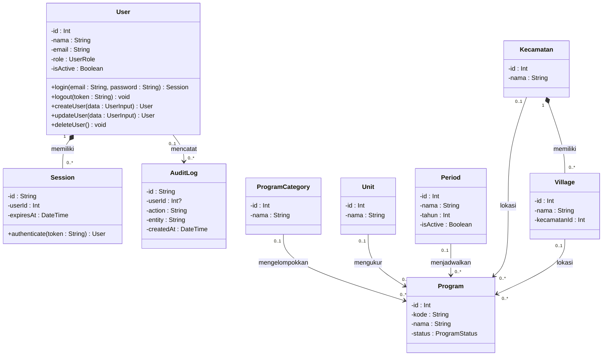
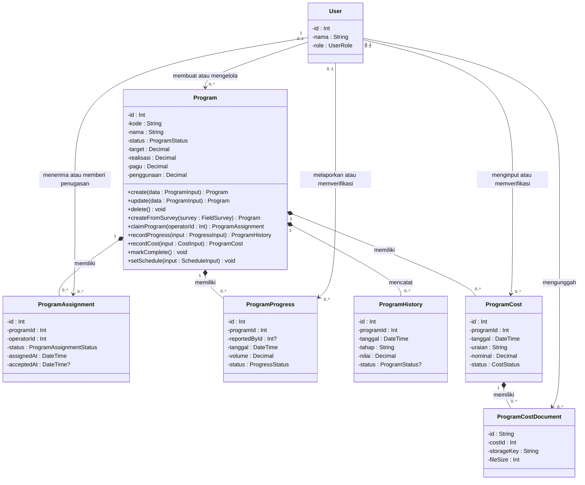
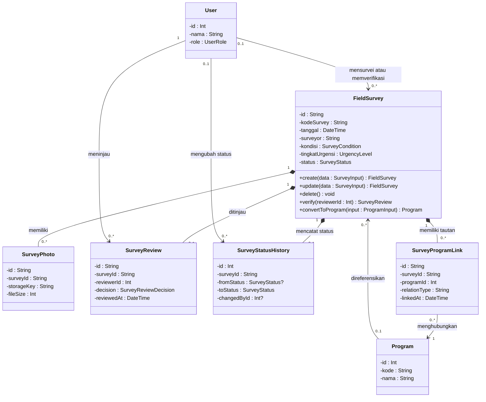
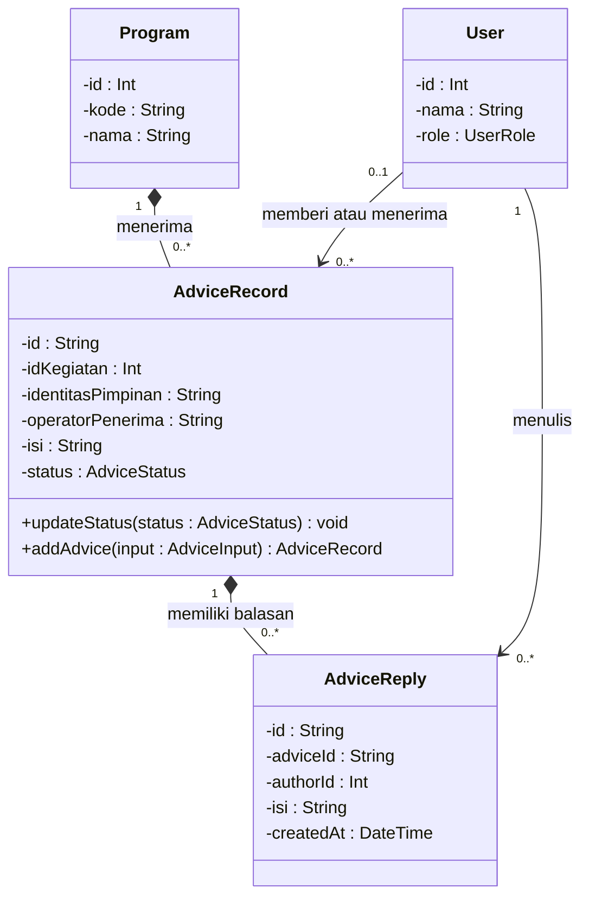

# Class Diagram SIMP Kuningan v3

Dokumen ini memodelkan skema Prisma sebagai diagram kelas domain. Diagram
memakai sintaks resmi Mermaid class diagram untuk visibilitas UML, relasi,
label, komposisi, dan kardinalitas.

Rujukan sintaks Mermaid:
[Class diagrams - Mermaid](https://mermaid.js.org/syntax/classDiagram.html)

## 1. Cara memakai diagram

Diagram penuh di bawah tetap menjadi **acuan keterlacakan terhadap basis data**:
setiap `model` Prisma ditampilkan, sedangkan `enum` disajikan
dalam tabel pada bagian 3. Untuk analisis fitur, diagram tersebut sebaiknya
dibaca melalui empat konteks fungsional berikut,
bukan sebagai satu diagram kelas operasional yang besar:

### Identitas dan Data Master



### Manajemen Program



### Siklus Survei Lapangan



### Saran Pimpinan



View per konteks dipakai untuk komunikasi desain, pembagian pekerjaan, dan
analisis alur kerja. Diagram penuh tetap dipakai saat memeriksa migrasi,
kardinalitas, `onDelete`, atau kelengkapan model database.

Untuk penempatan pada laporan, gunakan keterangan berikut:

- **Gambar 4.1 Diagram Kelas Konteks Identitas dan Data Master**
- **Gambar 4.2 Diagram Kelas Konteks Manajemen Program**
- **Gambar 4.3 Diagram Kelas Konteks Siklus Survei Lapangan**
- **Gambar 4.4 Diagram Kelas Konteks Saran Pimpinan**

Setiap gambar dijelaskan dengan satu paragraf mengenai tanggung jawab konteks,
alur utama, dan relasi pentingnya. Atribut lengkap tetap tersedia pada tabel
kamus data, sedangkan diagram penuh pada bagian lampiran digunakan untuk
acuan keterlacakan terhadap skema Prisma.

### Hak akses berdasarkan peran

| Peran | Operasi |
|---|---|
| Admin | `createUser`, `updateUser`, `deleteUser` |
| Admin | `create`, `update`, `delete` pada `Program` |
| Admin | `create`, `update`, `delete` pada `FieldSurvey` |
| Admin | `createFromSurvey`, `convertToProgram` |
| Operator | `claimProgram`, `setSchedule` |
| Operator | `recordProgress`, `markComplete` |
| Operator | `recordCost`, `updateStatus` pada `AdviceRecord` |
| Pimpinan | `addAdvice` |

Operasi `login`, `logout`, dan `authenticate` berkaitan dengan autentikasi.
Operasi `create`, `update`, dan `delete` pada diagram merepresentasikan aksi
pengguna, bukan pemanggilan langsung method Prisma. Model pendukung yang tidak
memiliki operasi tersendiri, seperti `ProgramProgress`, `SurveyPhoto`, dan
`ProgramCostDocument`, tetap ditampilkan karena merupakan bagian dari skema,
tetapi tidak diberi operasi buatan.

## 2. Diagram kelas entitas domain (lampiran keterlacakan)

```mermaid
classDiagram
    direction TB

    %% Identitas, autentikasi, dan audit
    class User {
        -id : Int
        -nama : String
        -email : String
        -role : UserRole
        -passwordHash : String?
        -isActive : Boolean
        -lastLoginAt : DateTime?
        -deletedAt : DateTime?
        -createdAt : DateTime
        -updatedAt : DateTime
        +login(email : String, password : String) Session
        +logout(token : String) void
        +createUser(data : UserInput) User
        +updateUser(data : UserInput) User
        +deleteUser() void
    }

    class Session {
        -id : String
        -tokenHash : String
        -userId : Int
        -expiresAt : DateTime
        -createdAt : DateTime
        +authenticate(token : String) User
    }

    class AuditLog {
        -id : String
        -userId : Int?
        -action : String
        -entity : String
        -entityId : String
        -details : Json?
        -requestId : String?
        -ipAddress : String?
        -userAgent : String?
        -createdAt : DateTime
    }

    %% Master data
    class ProgramCategory {
        -id : Int
        -nama : String
    }

    class Unit {
        -id : Int
        -nama : String
    }

    class Kecamatan {
        -id : Int
        -nama : String
    }

    class Village {
        -id : Int
        -nama : String
        -kecamatanId : Int
    }

    class Period {
        -id : Int
        -nama : String
        -tahun : Int
        -tanggalMulai : DateTime?
        -tanggalSelesai : DateTime?
        -isActive : Boolean
        -createdAt : DateTime
        -updatedAt : DateTime
    }

    %% Core entities
    class Program {
        -id : Int
        -kode : String
        -nama : String
        -namaKegiatan : String?
        -kategori : String
        -categoryId : Int?
        -periodId : Int?
        -lokasi : String
        -kecamatan : String?
        -kecamatanId : Int?
        -desaKelurahan : String?
        -detailLokasi : String?
        -pj : String
        -operatorPengelola : String?
        -operatorPengelolaId : Int?
        -createdById : Int?
        -penanggungJawabDinas : String?
        -periode : String
        -jadwal : String?
        -satuan : String
        -unitId : Int?
        -villageId : Int?
        -targetAwal : Decimal
        -target : Decimal
        -targetVolume : Decimal?
        -realisasi : Decimal
        -realisasiVolume : Decimal?
        -status : ProgramStatus
        -update : String
        -sumber : String
        -catatan : String
        -pagu : Decimal
        -penggunaan : Decimal
        -penggunaanBiaya : Decimal?
        -penyedia : String?
        -direktur : String?
        -nilaiKontrak : Decimal?
        -noKontrak : String?
        -lebarJalan : Decimal?
        -kondisiJalan : String?
        -tanggalMulai : DateTime?
        -tanggalSelesai : DateTime?
        -createdAt : DateTime
        -updatedAt : DateTime
        -deletedAt : DateTime?
        -deletedById : Int?
        +create(data : ProgramInput) Program
        +update(data : ProgramInput) Program
        +delete() void
        +createFromSurvey(survey : FieldSurvey) Program
        +claimProgram(operatorId : Int) ProgramAssignment
        +recordProgress(input : ProgressInput) ProgramHistory
        +recordCost(input : CostInput) ProgramCost
        +markComplete() void
        +setSchedule(input : ScheduleInput) void
    }

    class FieldSurvey {
        -id : String
        -kodeSurvey : String
        -tanggal : DateTime
        -surveyor : String
        -surveyorId : Int?
        -programId : Int?
        -namaKegiatan : String
        -kategori : String
        -kecamatan : String
        -kecamatanId : Int?
        -villageId : Int?
        -desaKelurahan : String
        -detailLokasi : String
        -koordinat : String?
        -kondisi : SurveyCondition
        -panjang : Decimal?
        -lebar : Decimal?
        -luasVolume : Decimal?
        -satuan : String?
        -tipeKonstruksi : String?
        -estimasiBiaya : Decimal?
        -tingkatUrgensi : UrgencyLevel
        -uraianTemuan : String
        -rekomendasi : String
        -kontakPendamping : String?
        -foto : Boolean
        -fotoUrl : String?
        -status : SurveyStatus
        -submittedAt : DateTime?
        -verifiedAt : DateTime?
        -verifiedById : Int?
        -rejectionReason : String?
        -deletedAt : DateTime?
        -createdAt : DateTime
        -updatedAt : DateTime
        +create(data : SurveyInput) FieldSurvey
        +update(data : SurveyInput) FieldSurvey
        +delete() void
        +verify(reviewerId : Int) SurveyReview
        +convertToProgram(input : ProgramInput) Program
    }

    class AdviceRecord {
        -id : String
        -idKegiatan : Int
        -namaKegiatan : String
        -identitasPimpinan : String
        -pimpinanId : Int?
        -operatorPenerima : String
        -operatorId : Int?
        -isi : String
        -tanggal : DateTime
        -status : AdviceStatus
        -createdAt : DateTime
        -updatedAt : DateTime
        +addAdvice(input : AdviceInput) AdviceRecord
        +updateStatus(status : AdviceStatus) void
    }

    %% Alur kerja program
    class ProgramAssignment {
        -id : Int
        -programId : Int
        -operatorId : Int
        -assignedById : Int?
        -status : ProgramAssignmentStatus
        -assignedAt : DateTime
        -acceptedAt : DateTime?
        -releasedAt : DateTime?
        -notes : String?
    }

    class ProgramProgress {
        -id : Int
        -programId : Int
        -reportedById : Int?
        -verifiedById : Int?
        -tanggal : DateTime
        -tahap : String
        -volume : Decimal
        -satuan : String
        -persentase : Decimal?
        -keterangan : String
        -status : ProgressStatus
        -verifiedAt : DateTime?
        -rejectionReason : String?
        -createdAt : DateTime
        -updatedAt : DateTime
    }

    class ProgramHistory {
        -id : Int
        -programId : Int
        -tanggal : DateTime
        -tahap : String
        -nilai : Decimal
        -satuan : String
        -keterangan : String
        -foto : Boolean
        -penginput : String
        -inputById : Int?
        -status : ProgramStatus?
        -createdAt : DateTime
    }

    class ProgramCost {
        -id : Int
        -programId : Int
        -tanggal : DateTime
        -uraian : String
        -nominal : Decimal
        -input : String
        -inputById : Int?
        -bukti : Boolean
        -kategori : String?
        -status : CostStatus
        -verifiedById : Int?
        -verifiedAt : DateTime?
        -rejectionReason : String?
        -createdAt : DateTime
    }

    class ProgramCostDocument {
        -id : String
        -costId : Int
        -storageKey : String
        -originalName : String
        -mimeType : String
        -fileSize : Int
        -uploadedById : Int?
        -createdAt : DateTime
    }

    %% Alur kerja survei
    class SurveyPhoto {
        -id : String
        -surveyId : String
        -storageKey : String
        -originalName : String
        -mimeType : String
        -fileSize : Int
        -caption : String?
        -latitude : Decimal?
        -longitude : Decimal?
        -uploadedById : Int?
        -createdAt : DateTime
    }

    class SurveyReview {
        -id : String
        -surveyId : String
        -reviewerId : Int
        -decision : SurveyReviewDecision
        -notes : String?
        -reviewedAt : DateTime
    }

    class SurveyStatusHistory {
        -id : Int
        -surveyId : String
        -fromStatus : SurveyStatus?
        -toStatus : SurveyStatus
        -changedById : Int?
        -reason : String?
        -createdAt : DateTime
    }

    class SurveyProgramLink {
        -id : String
        -surveyId : String
        -programId : Int
        -linkedById : Int?
        -relationType : String
        -linkedAt : DateTime
    }

    class AdviceReply {
        -id : String
        -adviceId : String
        -authorId : Int
        -isi : String
        -createdAt : DateTime
    }

    %% Satu garis per pasangan kelas; beberapa peran FK digabung.
    User "1" *-- "0..*" Session : memiliki
    User "0..1" --> "0..*" AuditLog : mencatat
    User "0..1" --> "0..*" Program : membuat, mengelola, atau menghapus
    User "0..1" --> "0..*" FieldSurvey : mensurvei atau memverifikasi
    User "1" --> "0..*" ProgramAssignment : menugaskan atau menerima
    User "0..1" --> "0..*" ProgramProgress : melaporkan atau memverifikasi
    User "0..1" --> "0..*" ProgramCost : menginput atau memverifikasi
    User "0..1" --> "0..*" ProgramCostDocument : mengunggah
    User "0..1" --> "0..*" SurveyPhoto : mengunggah
    User "1" --> "0..*" SurveyReview : meninjau
    User "0..1" --> "0..*" SurveyStatusHistory : mengubah status
    User "0..1" --> "0..*" SurveyProgramLink : menautkan
    User "0..1" --> "0..*" AdviceRecord : memberi atau menerima
    User "1" --> "0..*" AdviceReply : menulis

    Kecamatan "1" *-- "0..*" Village : memiliki
    ProgramCategory "0..1" --> "0..*" Program : mengelompokkan
    Unit "0..1" --> "0..*" Program : mengukur
    Period "0..1" --> "0..*" Program : menjadwalkan
    Kecamatan "0..1" --> "0..*" Program : menjadi lokasi
    Village "0..1" --> "0..*" Program : menjadi lokasi
    Kecamatan "0..1" --> "0..*" FieldSurvey : menjadi lokasi
    Village "0..1" --> "0..*" FieldSurvey : menjadi lokasi

    Program "1" *-- "0..*" ProgramAssignment : memiliki
    Program "1" *-- "0..*" ProgramProgress : memiliki
    Program "1" *-- "0..*" ProgramHistory : mencatat
    Program "1" *-- "0..*" ProgramCost : memiliki
    Program "0..1" --> "0..*" FieldSurvey : direferensikan
    Program "1" *-- "0..*" SurveyProgramLink : menautkan
    Program "1" *-- "0..*" AdviceRecord : menerima
    ProgramCost "1" *-- "0..*" ProgramCostDocument : memiliki

    FieldSurvey "1" *-- "0..*" SurveyPhoto : memiliki
    FieldSurvey "1" *-- "0..*" SurveyReview : memiliki
    FieldSurvey "1" *-- "0..*" SurveyStatusHistory : mencatat status
    FieldSurvey "1" *-- "0..*" SurveyProgramLink : memiliki
    AdviceRecord "1" *-- "0..*" AdviceReply : memiliki
```



### Aturan membaca relasi

- Diagram menggunakan arah `TB` agar identitas dan data master berada di atas,
  entitas inti di tengah, dan alur kerja turunannya berada di bawah.
- Setiap pasangan kelas hanya mempunyai satu garis. Bila skema mempunyai
    beberapa foreign key antara pasangan yang sama, perannya digabung dalam satu
    label berbahasa Indonesia. Untuk pasangan dengan satu FK wajib dan FK lain
    opsional, kardinalitas garis mengikuti FK wajib dan FK opsional dijelaskan
    pada tabel atau uraian relasi.
- `*--` dipakai untuk child yang mengikuti penghapusan parent melalui
  `onDelete: Cascade`.
- `-->` dipakai untuk foreign key referensi dengan `SetNull`, `Restrict`, atau
  relasi asosiasi biasa.
- `ProgramHistory` tetap ditampilkan karena merupakan model skema dan dipakai
    sebagai snapshot kompatibilitas dari pencatatan progres pada aplikasi.
    Pencatatan progres saat ini direpresentasikan oleh `ProgramHistory`, sedangkan
    `ProgramProgress` disiapkan untuk alur pengajuan dan verifikasi progres.
- `FieldSurvey` memiliki relasi langsung `programId` sekaligus
  `SurveyProgramLink`. Keduanya tetap ditampilkan karena keduanya benar-benar
    ada di skema dan memiliki makna berbeda: referensi program utama dan
  catatan hubungan konversi.
- Tidak ada class di diagram yang tidak berasal dari model Prisma.

## 3. Enumerasi

Enumerasi ditampilkan sebagai tabel agar ringkas dan mudah dibaca pada
laporan. Nilai yang digunakan aplikasi tetap mengikuti enum Prisma.

| Enumerasi | Nilai |
|---|---|
| `UserRole` | `ADMIN`, `OPERATOR`, `PIMPINAN` |
| `ProgramStatus` | `BELUM_DIKERJAKAN`, `SEDANG_DIKERJAKAN`, `SELESAI_DIKERJAKAN` |
| `ProgramAssignmentStatus` | `DITUGASKAN`, `DITERIMA`, `DITOLAK`, `DILEPAS` |
| `ProgressStatus` | `DRAFT`, `DIAJUKAN`, `DIVERIFIKASI`, `DITOLAK` |
| `CostStatus` | `DRAFT`, `DIAJUKAN`, `DIVERIFIKASI`, `DITOLAK` |
| `SurveyCondition` | `BAIK`, `RUSAK_RINGAN`, `RUSAK_SEDANG`, `RUSAK_BERAT` |
| `UrgencyLevel` | `RENDAH`, `SEDANG`, `TINGGI_MENDESAK` |
| `SurveyStatus` | `DRAFT`, `SELESAI_SURVEY`, `MENUNGGU_VERIFIKASI`, `PERLU_REVISI`, `DIVERIFIKASI`, `DIKONVERSI` |
| `SurveyReviewDecision` | `DISETUJUI`, `DITOLAK`, `PERLU_REVISI` |
| `AdviceStatus` | `BELUM_DITINDAKLANJUTI`, `SUDAH_DITINDAKLANJUTI` |

## 4. Alur status domain

```text
Survei:
DRAFT -> SELESAI_SURVEY -> MENUNGGU_VERIFIKASI
      -> PERLU_REVISI -> MENUNGGU_VERIFIKASI
      -> DIVERIFIKASI -> DIKONVERSI

Program:
BELUM_DIKERJAKAN -> SEDANG_DIKERJAKAN -> SELESAI_DIKERJAKAN

Progress dan biaya:
DRAFT -> DIAJUKAN -> DIVERIFIKASI
                  -> DITOLAK

Saran:
BELUM_DITINDAKLANJUTI -> SUDAH_DITINDAKLANJUTI
```

Jika `SurveyReviewDecision` bernilai `DITOLAK`, status survei diubah menjadi
`PERLU_REVISI`, karena `SurveyStatus` tidak memiliki nilai `DITOLAK`.
Konversi survei hanya boleh dilakukan setelah survei diverifikasi Admin.
Konversi mengisi `FieldSurvey.programId`, mengubah status menjadi `DIKONVERSI`,
dan membuat `SurveyProgramLink`.

## 5. Catatan pemodelan

| Elemen | Konvensi |
|---|---|
| Atribut privat | `-nama : Tipe` |
| Operasi publik | `+nama(parameter : Tipe) ReturnType` |
| Nilai nullable | `Tipe?` |
| Koleksi | Direpresentasikan oleh kardinalitas `0..*` pada relasi |
| Model Prisma | Satu kelas untuk setiap `model` pada skema |
| Enum Prisma | Disajikan sebagai tabel pada bagian 3, bukan sebagai kelas diagram |

Operasi pada diagram adalah operasi domain yang telah menjadi kontrak backend
atau aturan tetap alur kerja. Operasi penyimpanan seperti `findMany`, `create`,
dan `update` tidak ditampilkan karena merupakan tanggung jawab repository.
