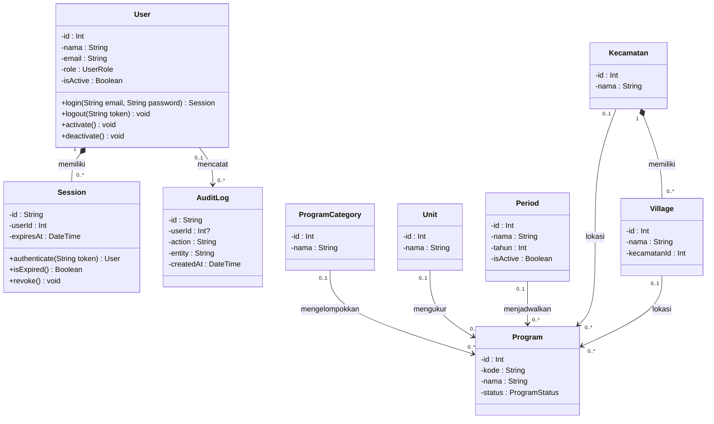
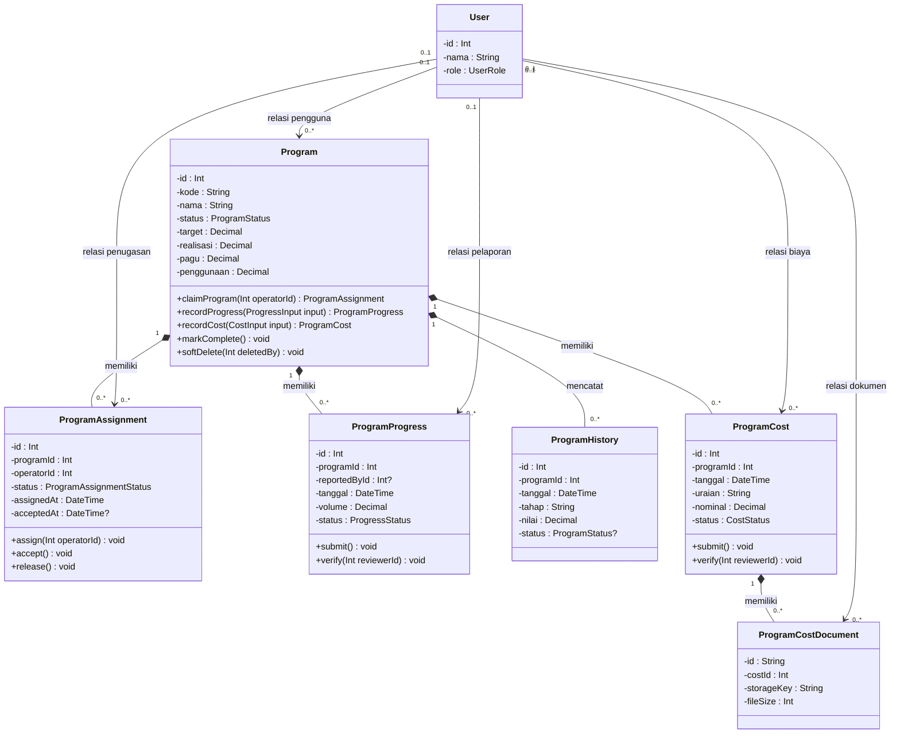
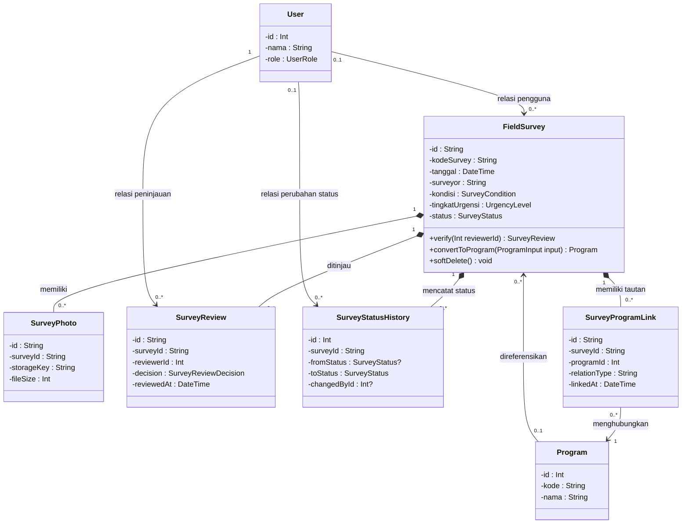
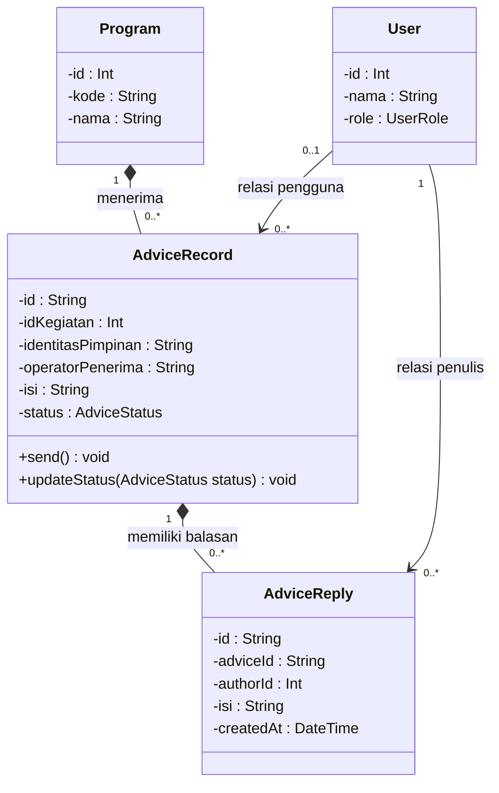

# Class Diagram SIMP Kuningan v3

Dokumen ini memodelkan schema Prisma sebagai class diagram domain. Diagram
memakai sintaks resmi Mermaid class diagram untuk visibility UML, relasi,
label, komposisi, dan kardinalitas.

Rujukan sintaks Mermaid:
[Class diagrams - Mermaid](https://mermaid.js.org/syntax/classDiagram.html)

## 1. Cara memakai diagram

Diagram penuh di bawah tetap menjadi **baseline traceability terhadap
database**: setiap `model` Prisma ditampilkan, sedangkan `enum` disajikan
dalam tabel pada bagian 3. Untuk analisis fitur, diagram tersebut sebaiknya
dibaca melalui empat bounded context berikut,
bukan sebagai satu class diagram operasional yang besar:

### Identitas dan Data Master



### Manajemen Program



### Siklus Survei Lapangan



### Saran Pimpinan



View per konteks dipakai untuk komunikasi desain, pembagian pekerjaan, dan
analisis workflow. Diagram penuh tetap dipakai saat memeriksa migration,
kardinalitas, `onDelete`, atau kelengkapan model database.

Untuk penempatan pada laporan, gunakan keterangan berikut:

- **Gambar 4.1 Class Diagram Konteks Identitas dan Data Master**
- **Gambar 4.2 Class Diagram Konteks Manajemen Program**
- **Gambar 4.3 Class Diagram Konteks Siklus Survei Lapangan**
- **Gambar 4.4 Class Diagram Konteks Saran Pimpinan**

Setiap gambar dijelaskan dengan satu paragraf mengenai tanggung jawab konteks,
alur utama, dan relasi pentingnya. Atribut lengkap tetap tersedia pada tabel
kamus data, sedangkan diagram penuh pada bagian lampiran digunakan untuk
traceability terhadap schema Prisma.

## 2. Class diagram entitas domain (lampiran traceability)

```mermaid
classDiagram
    direction TB

    %% Identity, authentication, and audit
    class User {
        -id : Int
        -nama : String
        -email : String
        -role : UserRole
        -passwordHash : String?
        -isActive : Boolean
        -lastLoginAt : DateTime?
        -deletedAt : DateTime?
        -createdAt : DateTime
        -updatedAt : DateTime
        +login(String email, String password) Session
        +logout(String token) void
        +activate() void
        +deactivate() void
    }

    class Session {
        -id : String
        -tokenHash : String
        -userId : Int
        -expiresAt : DateTime
        -createdAt : DateTime
        +authenticate(String token) User
        +isExpired() Boolean
        +revoke() void
    }

    class AuditLog {
        -id : String
        -userId : Int?
        -action : String
        -entity : String
        -entityId : String
        -details : Json?
        -requestId : String?
        -ipAddress : String?
        -userAgent : String?
        -createdAt : DateTime
    }

    %% Master data
    class ProgramCategory {
        -id : Int
        -nama : String
    }

    class Unit {
        -id : Int
        -nama : String
    }

    class Kecamatan {
        -id : Int
        -nama : String
    }

    class Village {
        -id : Int
        -nama : String
        -kecamatanId : Int
    }

    class Period {
        -id : Int
        -nama : String
        -tahun : Int
        -tanggalMulai : DateTime?
        -tanggalSelesai : DateTime?
        -isActive : Boolean
        -createdAt : DateTime
        -updatedAt : DateTime
    }

    %% Core entities
    class Program {
        -id : Int
        -kode : String
        -nama : String
        -namaKegiatan : String?
        -kategori : String
        -categoryId : Int?
        -periodId : Int?
        -lokasi : String
        -kecamatan : String?
        -kecamatanId : Int?
        -desaKelurahan : String?
        -detailLokasi : String?
        -pj : String
        -operatorPengelola : String?
        -operatorPengelolaId : Int?
        -createdById : Int?
        -penanggungJawabDinas : String?
        -periode : String
        -jadwal : String?
        -satuan : String
        -unitId : Int?
        -villageId : Int?
        -targetAwal : Decimal
        -target : Decimal
        -targetVolume : Decimal?
        -realisasi : Decimal
        -realisasiVolume : Decimal?
        -status : ProgramStatus
        -update : String
        -sumber : String
        -catatan : String
        -pagu : Decimal
        -penggunaan : Decimal
        -penggunaanBiaya : Decimal?
        -penyedia : String?
        -direktur : String?
        -nilaiKontrak : Decimal?
        -noKontrak : String?
        -lebarJalan : Decimal?
        -kondisiJalan : String?
        -tanggalMulai : DateTime?
        -tanggalSelesai : DateTime?
        -createdAt : DateTime
        -updatedAt : DateTime
        -deletedAt : DateTime?
        -deletedById : Int?
        +claimProgram(Int operatorId) ProgramAssignment
        +recordProgress(ProgressInput input) ProgramProgress
        +recordCost(CostInput input) ProgramCost
        +markComplete() void
        +softDelete(Int deletedById) void
    }

    class FieldSurvey {
        -id : String
        -kodeSurvey : String
        -tanggal : DateTime
        -surveyor : String
        -surveyorId : Int?
        -programId : Int?
        -namaKegiatan : String
        -kategori : String
        -kecamatan : String
        -kecamatanId : Int?
        -villageId : Int?
        -desaKelurahan : String
        -detailLokasi : String
        -koordinat : String?
        -kondisi : SurveyCondition
        -panjang : Decimal?
        -lebar : Decimal?
        -luasVolume : Decimal?
        -satuan : String?
        -tipeKonstruksi : String?
        -estimasiBiaya : Decimal?
        -tingkatUrgensi : UrgencyLevel
        -uraianTemuan : String
        -rekomendasi : String
        -kontakPendamping : String?
        -foto : Boolean
        -fotoUrl : String?
        -status : SurveyStatus
        -submittedAt : DateTime?
        -verifiedAt : DateTime?
        -verifiedById : Int?
        -rejectionReason : String?
        -deletedAt : DateTime?
        -createdAt : DateTime
        -updatedAt : DateTime
        +verify(Int reviewerId) SurveyReview
        +convertToProgram(ProgramInput input) Program
        +softDelete() void
    }

    class AdviceRecord {
        -id : String
        -idKegiatan : Int
        -namaKegiatan : String
        -identitasPimpinan : String
        -pimpinanId : Int?
        -operatorPenerima : String
        -operatorId : Int?
        -isi : String
        -tanggal : DateTime
        -status : AdviceStatus
        -createdAt : DateTime
        -updatedAt : DateTime
        +send() void
        +updateStatus(AdviceStatus status) void
    }

    %% Program workflow
    class ProgramAssignment {
        -id : Int
        -programId : Int
        -operatorId : Int
        -assignedById : Int?
        -status : ProgramAssignmentStatus
        -assignedAt : DateTime
        -acceptedAt : DateTime?
        -releasedAt : DateTime?
        -notes : String?
    }

    class ProgramProgress {
        -id : Int
        -programId : Int
        -reportedById : Int?
        -verifiedById : Int?
        -tanggal : DateTime
        -tahap : String
        -volume : Decimal
        -satuan : String
        -persentase : Decimal?
        -keterangan : String
        -status : ProgressStatus
        -verifiedAt : DateTime?
        -rejectionReason : String?
        -createdAt : DateTime
        -updatedAt : DateTime
    }

    class ProgramHistory {
        -id : Int
        -programId : Int
        -tanggal : DateTime
        -tahap : String
        -nilai : Decimal
        -satuan : String
        -keterangan : String
        -foto : Boolean
        -penginput : String
        -inputById : Int?
        -status : ProgramStatus?
        -createdAt : DateTime
    }

    class ProgramCost {
        -id : Int
        -programId : Int
        -tanggal : DateTime
        -uraian : String
        -nominal : Decimal
        -input : String
        -inputById : Int?
        -bukti : Boolean
        -kategori : String?
        -status : CostStatus
        -verifiedById : Int?
        -verifiedAt : DateTime?
        -rejectionReason : String?
        -createdAt : DateTime
    }

    class ProgramCostDocument {
        -id : String
        -costId : Int
        -storageKey : String
        -originalName : String
        -mimeType : String
        -fileSize : Int
        -uploadedById : Int?
        -createdAt : DateTime
    }

    %% Survey workflow
    class SurveyPhoto {
        -id : String
        -surveyId : String
        -storageKey : String
        -originalName : String
        -mimeType : String
        -fileSize : Int
        -caption : String?
        -latitude : Decimal?
        -longitude : Decimal?
        -uploadedById : Int?
        -createdAt : DateTime
    }

    class SurveyReview {
        -id : String
        -surveyId : String
        -reviewerId : Int
        -decision : SurveyReviewDecision
        -notes : String?
        -reviewedAt : DateTime
    }

    class SurveyStatusHistory {
        -id : Int
        -surveyId : String
        -fromStatus : SurveyStatus?
        -toStatus : SurveyStatus
        -changedById : Int?
        -reason : String?
        -createdAt : DateTime
    }

    class SurveyProgramLink {
        -id : String
        -surveyId : String
        -programId : Int
        -linkedById : Int?
        -relationType : String
        -linkedAt : DateTime
    }

    class AdviceReply {
        -id : String
        -adviceId : String
        -authorId : Int
        -isi : String
        -createdAt : DateTime
    }

    %% One edge per class pair. Multiple FK roles are combined in one label.
    User "1" *-- "0..*" Session : owns
    User "0..1" --> "0..*" AuditLog : records
    User "0..*" --> "0..*" Program : creates / operates / deletes
    User "0..*" --> "0..*" FieldSurvey : surveys / verifies
    User "0..*" --> "0..*" ProgramAssignment : assigns / receives
    User "0..*" --> "0..*" ProgramProgress : reports / verifies
    User "0..*" --> "0..*" ProgramCost : inputs / verifies
    User "0..1" --> "0..*" ProgramCostDocument : uploads
    User "0..1" --> "0..*" SurveyPhoto : uploads
    User "1" --> "0..*" SurveyReview : reviews
    User "0..1" --> "0..*" SurveyStatusHistory : changes
    User "0..1" --> "0..*" SurveyProgramLink : links
    User "0..*" --> "0..*" AdviceRecord : issues / receives
    User "1" --> "0..*" AdviceReply : writes

    Kecamatan "1" *-- "0..*" Village : contains
    ProgramCategory "0..1" --> "0..*" Program : categorizes
    Unit "0..1" --> "0..*" Program : measures
    Period "0..1" --> "0..*" Program : schedules
    Kecamatan "0..1" --> "0..*" Program : locates
    Village "0..1" --> "0..*" Program : locates
    Kecamatan "0..1" --> "0..*" FieldSurvey : locates
    Village "0..1" --> "0..*" FieldSurvey : locates

    Program "1" *-- "0..*" ProgramAssignment : has
    Program "1" *-- "0..*" ProgramProgress : has
    Program "1" *-- "0..*" ProgramHistory : records
    Program "1" *-- "0..*" ProgramCost : has
    Program "0..1" --> "0..*" FieldSurvey : referenced by programId
    Program "1" *-- "0..*" SurveyProgramLink : links
    Program "1" *-- "0..*" AdviceRecord : receives
    ProgramCost "1" *-- "0..*" ProgramCostDocument : has

    FieldSurvey "1" *-- "0..*" SurveyPhoto : has
    FieldSurvey "1" *-- "0..*" SurveyReview : has
    FieldSurvey "1" *-- "0..*" SurveyStatusHistory : has
    FieldSurvey "1" *-- "0..*" SurveyProgramLink : links
    AdviceRecord "1" *-- "0..*" AdviceReply : has
```



### Aturan membaca relasi

- Diagram menggunakan arah `TB` agar identitas dan master data berada di atas,
  entitas inti di tengah, dan workflow turunannya berada di bawah.
- Setiap pasangan class hanya mempunyai satu garis. Bila schema mempunyai
  beberapa foreign key antara pasangan yang sama, perannya digabung dalam satu
  label, misalnya `creates / operates / deletes`.
- `*--` dipakai untuk child yang mengikuti penghapusan parent melalui
  `onDelete: Cascade`.
- `-->` dipakai untuk foreign key referensi dengan `SetNull`, `Restrict`, atau
  relasi asosiasi biasa.
- Kardinalitas mengikuti optionality foreign key dan bentuk koleksi Prisma.
  Pada relasi User yang menggabungkan FK wajib dan opsional, kardinalitas
  menggambarkan cakupan pasangan secara ringkas; detail FK tetap terlihat pada
  atribut class.
- `ProgramHistory` tetap ditampilkan karena merupakan model schema dan dipakai
  sebagai snapshot kompatibilitas dari input progress. `ProgramProgress` adalah
  model workflow progress canonical.
- `FieldSurvey` memiliki relasi langsung `programId` sekaligus
  `SurveyProgramLink`. Keduanya tetap ditampilkan karena keduanya benar-benar
  ada di schema dan memiliki makna berbeda: referensi program utama dan
  catatan hubungan konversi.
- Tidak ada class di diagram yang tidak berasal dari model Prisma.

## 3. Enumeration

Enumeration ditampilkan sebagai tabel agar ringkas dan mudah dibaca pada
laporan. Nilai yang digunakan aplikasi tetap mengikuti enum Prisma.

| Enumeration | Nilai |
|---|---|
| `UserRole` | `ADMIN`, `OPERATOR`, `PIMPINAN` |
| `ProgramStatus` | `BELUM_DIKERJAKAN`, `SEDANG_DIKERJAKAN`, `SELESAI_DIKERJAKAN` |
| `ProgramAssignmentStatus` | `DITUGASKAN`, `DITERIMA`, `DITOLAK`, `DILEPAS` |
| `ProgressStatus` | `DRAFT`, `DIAJUKAN`, `DIVERIFIKASI`, `DITOLAK` |
| `CostStatus` | `DRAFT`, `DIAJUKAN`, `DIVERIFIKASI`, `DITOLAK` |
| `SurveyCondition` | `BAIK`, `RUSAK_RINGAN`, `RUSAK_SEDANG`, `RUSAK_BERAT` |
| `UrgencyLevel` | `RENDAH`, `SEDANG`, `TINGGI_MENDESAK` |
| `SurveyStatus` | `DRAFT`, `SELESAI_SURVEY`, `MENUNGGU_VERIFIKASI`, `PERLU_REVISI`, `DIVERIFIKASI`, `DIKONVERSI` |
| `SurveyReviewDecision` | `DISETUJUI`, `DITOLAK`, `PERLU_REVISI` |
| `AdviceStatus` | `BELUM_DITINDAKLANJUTI`, `SUDAH_DITINDAKLANJUTI` |

## 4. Alur status domain

```text
Survey:
DRAFT -> SELESAI_SURVEY -> MENUNGGU_VERIFIKASI
      -> PERLU_REVISI -> MENUNGGU_VERIFIKASI
      -> DIVERIFIKASI -> DIKONVERSI

Program:
BELUM_DIKERJAKAN -> SEDANG_DIKERJAKAN -> SELESAI_DIKERJAKAN

Progress dan biaya:
DRAFT -> DIAJUKAN -> DIVERIFIKASI
                  -> DITOLAK

Advice:
BELUM_DITINDAKLANJUTI -> SUDAH_DITINDAKLANJUTI
```

Konversi survey hanya boleh dilakukan setelah survey diverifikasi Admin.
Konversi mengisi `FieldSurvey.programId`, mengubah status menjadi `DIKONVERSI`,
dan membuat `SurveyProgramLink`.

## 5. Catatan pemodelan

| Elemen | Konvensi |
|---|---|
| Atribut private | `-nama : Tipe` |
| Operasi public | `+nama(Tipe parameter) ReturnType` |
| Nilai nullable | `Tipe?` |
| Koleksi | Direpresentasikan oleh kardinalitas `0..*` pada relasi |
| Model Prisma | Satu class untuk setiap `model` pada schema |
| Enum Prisma | Satu class `<<enumeration>>` untuk setiap `enum` pada schema |

Operasi pada diagram adalah operasi domain yang telah menjadi kontrak backend
atau invariant workflow. Operasi persistence seperti `findMany`, `create`, dan
`update` tidak ditampilkan karena merupakan tanggung jawab repository.
