# Class Diagram SIMP Kuningan v3

Dokumen ini adalah class diagram level implementasi berdasarkan model Prisma
terkini. Nama atribut memakai format UML `visibility nama : Tipe`, sedangkan
operasi memakai format `visibility nama(in parameter : Tipe) : ReturnType`.

## 1. Class diagram entitas domain

```mermaid
classDiagram
    direction TB

    %% ===== Level atas: User dan master data =====
    class User {
        -id : Int
        -nama : String
        -email : String
        -role : UserRole
        -passwordHash : String?
        -isActive : Boolean
        -lastLoginAt : DateTime?
        -deletedAt : DateTime?
        -createdAt : DateTime
        -updatedAt : DateTime
        +login(in email : String, in password : String) : Session
        +logout(in token : String) : void
        +activate() : void
        +deactivate() : void
    }

    class Kecamatan {
        -id : Int
        -nama : String
        +rename(in nama : String) : void
    }

    class ProgramCategory {
        -id : Int
        -nama : String
        +rename(in nama : String) : void
    }

    class Unit {
        -id : Int
        -nama : String
        +rename(in nama : String) : void
    }

    class Period {
        -id : Int
        -nama : String
        -tahun : Int
        -tanggalMulai : DateTime?
        -tanggalSelesai : DateTime?
        -isActive : Boolean
        +activate() : void
        +deactivate() : void
    }

    %% ===== Level 2 =====
    class Session {
        -id : String
        -tokenHash : String
        -userId : Int
        -expiresAt : DateTime
        -createdAt : DateTime
        +authenticate(in token : String) : User
        +isExpired() : Boolean
        +revoke() : void
    }

    class AuditLog {
        -id : String
        -userId : Int?
        -action : String
        -entity : String
        -entityId : String
        -details : Json?
        -requestId : String?
        -ipAddress : String?
        -userAgent : String?
        -createdAt : DateTime
        +record(in action : String, in entity : String, in entityId : String, in details : Json) : AuditLog
    }

    class Village {
        -id : Int
        -nama : String
        -kecamatanId : Int
        +rename(in nama : String) : void
    }

    %% ===== Level 3: entitas inti =====
    class Program {
        -id : Int
        -kode : String
        -nama : String
        -namaKegiatan : String?
        -kategori : String
        -categoryId : Int?
        -periodId : Int?
        -lokasi : String
        -kecamatanId : Int?
        -villageId : Int?
        -pj : String
        -operatorPengelolaId : Int?
        -createdById : Int?
        -unitId : Int?
        -target : Decimal
        -realisasi : Decimal
        -status : ProgramStatus
        -pagu : Decimal
        -penggunaan : Decimal
        -tanggalMulai : DateTime?
        -tanggalSelesai : DateTime?
        -deletedAt : DateTime?
        -deletedById : Int?
        +claimProgram(in operatorId : Int) : ProgramAssignment
        +assignOperator(in operatorId : Int, in assignedById : Int) : ProgramAssignment
        +recordProgress(in input : ProgressInput) : ProgramProgress
        +recordCost(in input : CostInput) : ProgramCost
        +submitCompletion() : void
        +markComplete() : void
        +softDelete(in deletedById : Int) : void
    }

    class FieldSurvey {
        -id : String
        -kodeSurvey : String
        -tanggal : DateTime
        -surveyorId : Int?
        -programId : Int?
        -namaKegiatan : String
        -kategori : String
        -kecamatanId : Int?
        -villageId : Int?
        -detailLokasi : String
        -kondisi : SurveyCondition
        -tingkatUrgensi : UrgencyLevel
        -uraianTemuan : String
        -rekomendasi : String
        -estimasiBiaya : Decimal?
        -status : SurveyStatus
        -submittedAt : DateTime?
        -verifiedAt : DateTime?
        -verifiedById : Int?
        -rejectionReason : String?
        -deletedAt : DateTime?
        +submit() : void
        +review(in reviewerId : Int, in decision : SurveyReviewDecision) : SurveyReview
        +convertToProgram(in input : ProgramInput) : Program
        +softDelete() : void
    }

    %% ===== Level 4: turunan Program, Survey, Advice =====
    class ProgramAssignment {
        -id : Int
        -programId : Int
        -operatorId : Int
        -assignedById : Int?
        -status : ProgramAssignmentStatus
        -assignedAt : DateTime
        -acceptedAt : DateTime?
        -releasedAt : DateTime?
        -notes : String?
        +accept() : void
        +reject(in reason : String) : void
        +release() : void
    }

    class ProgramProgress {
        -id : Int
        -programId : Int
        -reportedById : Int?
        -verifiedById : Int?
        -tanggal : DateTime
        -tahap : String
        -volume : Decimal
        -satuan : String
        -persentase : Decimal?
        -keterangan : String
        -status : ProgressStatus
        -verifiedAt : DateTime?
        -rejectionReason : String?
        +submit() : void
        +verify(in verifierId : Int) : void
        +reject(in reason : String) : void
    }

    class ProgramCost {
        -id : Int
        -programId : Int
        -tanggal : DateTime
        -uraian : String
        -nominal : Decimal
        -inputById : Int?
        -kategori : String?
        -status : CostStatus
        -verifiedById : Int?
        -verifiedAt : DateTime?
        -rejectionReason : String?
        +submit() : void
        +verify(in verifierId : Int) : void
        +reject(in reason : String) : void
    }

    class ProgramHistory {
        -id : Int
        -programId : Int
        -tanggal : DateTime
        -tahap : String
        -nilai : Decimal
        -satuan : String
        -keterangan : String
        -foto : Boolean
        -inputById : Int?
        -status : ProgramStatus?
    }

    class SurveyProgramLink {
        -id : String
        -surveyId : String
        -programId : Int
        -linkedById : Int?
        -relationType : String
        -linkedAt : DateTime
        +link() : void
        +unlink() : void
    }

    class SurveyPhoto {
        -id : String
        -surveyId : String
        -storageKey : String
        -originalName : String
        -mimeType : String
        -fileSize : Int
        -caption : String?
        -latitude : Decimal?
        -longitude : Decimal?
        -uploadedById : Int?
        +download() : Binary
        +remove() : void
    }

    class SurveyReview {
        -id : String
        -surveyId : String
        -reviewerId : Int
        -decision : SurveyReviewDecision
        -notes : String?
        -reviewedAt : DateTime
        +approve() : void
        +requestRevision(in notes : String) : void
        +reject(in reason : String) : void
    }

    class SurveyStatusHistory {
        -id : Int
        -surveyId : String
        -fromStatus : SurveyStatus?
        -toStatus : SurveyStatus
        -changedById : Int?
        -reason : String?
        -createdAt : DateTime
        +recordTransition(in toStatus : SurveyStatus, in reason : String) : void
    }

    class AdviceRecord {
        -id : String
        -idKegiatan : Int
        -pimpinanId : Int?
        -operatorId : Int?
        -isi : String
        -tanggal : DateTime
        -status : String
        +send() : void
        +updateStatus(in status : String) : void
    }

    %% ===== Level 5 =====
    class ProgramCostDocument {
        -id : String
        -costId : Int
        -storageKey : String
        -originalName : String
        -mimeType : String
        -fileSize : Int
        -uploadedById : Int?
        +download() : Binary
        +remove() : void
    }

    class AdviceReply {
        -id : String
        -adviceId : String
        -authorId : Int
        -isi : String
        -createdAt : DateTime
        +reply(in isi : String) : void
    }

    %% ===== Relasi: User dan Identity/Audit =====
    User "1" *-- "0..*" Session : owns
    User "1" --> "0..*" AuditLog : performs

    %% ===== Relasi: master data dan lokasi =====
    Kecamatan "1" *-- "0..*" Village : contains
    ProgramCategory "0..1" --> "0..*" Program : categorizes
    Unit "0..1" --> "0..*" Program : measures
    Period "0..1" --> "0..*" Program : schedules
    Kecamatan "0..1" --> "0..*" Program : locates
    Village "0..1" --> "0..*" Program : locates
    Kecamatan "0..1" --> "0..*" FieldSurvey : locates
    Village "0..1" --> "0..*" FieldSurvey : locates

    %% ===== Relasi: User ke entitas inti =====
    User "1" --> "0..*" Program : creates / operates / deletes
    User "1" --> "0..*" FieldSurvey : surveys / verifies
    User "1" --> "0..*" AdviceRecord : issues / receives

    %% ===== Relasi: Program =====
    Program "1" *-- "0..*" ProgramAssignment : has
    Program "1" *-- "0..*" ProgramProgress : has
    Program "1" *-- "0..*" ProgramCost : has
    Program "1" *-- "0..*" ProgramHistory : legacy progress
    Program "1" *-- "0..*" AdviceRecord : receives
    Program "1" *-- "0..*" SurveyProgramLink : links
    ProgramCost "1" *-- "0..*" ProgramCostDocument : has

    %% ===== Relasi: Survey =====
    FieldSurvey "1" *-- "0..*" SurveyProgramLink : links
    FieldSurvey "1" *-- "0..*" SurveyPhoto : has
    FieldSurvey "1" *-- "0..*" SurveyReview : has
    FieldSurvey "1" *-- "0..*" SurveyStatusHistory : has

    %% ===== Relasi: Advice =====
    AdviceRecord "1" *-- "0..*" AdviceReply : has
```



### Aturan membaca relasi

- Diagram menggunakan arah `TB` (top-to-bottom): User dan master data di
  atas, entitas inti (`Program`, `FieldSurvey`) di tengah, dan entitas
  turunan di bawah.
- Garis dari `User` hanya digambar ke entitas inti dan ke `Session` serta
  `AuditLog`. Relasi `User` ke entitas turunan tidak digambar supaya garis
  tidak menembus class lain. Relasi tersebut dirinci pada tabel berikut.
- Setiap pasangan kelas hanya digambar dengan **satu garis satu arah**.
- Tidak ada garis balik dari child ke parent. Arah garis dipilih dari entitas
  referensi/owner menuju entitas yang dimilikinya atau digunakan.
- Bila satu pasangan memiliki beberapa peran, perannya digabung dengan `/`
  pada satu label relasi, misalnya `creates / operates / deletes`.
- `*--` dipakai untuk komposisi karena child mengikuti penghapusan parent
  (`onDelete: Cascade`).
- `-->` dipakai untuk asosiasi atau referensi dengan `SetNull`, `Restrict`,
  atau relasi biasa.
- Multiplicity `0..1`, `1`, dan `0..*` mengikuti nullable foreign key dan
  koleksi relasi pada schema Prisma.
- `ProgramHistory` tetap ditampilkan sebagai model legacy. Progres baru
  sebaiknya menggunakan `ProgramProgress`.
- Relasi langsung legacy `Program.programId` pada `FieldSurvey` tidak digambar
  karena hubungan survey-program sudah diwakili oleh `SurveyProgramLink`.
  Field tersebut tetap ada sementara untuk kompatibilitas migrasi.
- Saat diekspor ke laporan, render ke SVG/PNG beresolusi tinggi dan gunakan
  halaman A3 landscape atau skala 80--90% agar kompartemen class tidak
  terpotong.

### Relasi User ke entitas turunan

Semuanya berupa asosiasi `User "1" --> "0..*"` (foreign key ke `User`).

| Entitas | Peran User | Atribut FK |
|---|---|---|
| ProgramAssignment | assigns / receives | `assignedById`, `operatorId` |
| ProgramProgress | reports / verifies | `reportedById`, `verifiedById` |
| ProgramCost | inputs / verifies | `inputById`, `verifiedById` |
| ProgramCostDocument | uploads | `uploadedById` |
| SurveyPhoto | uploads | `uploadedById` |
| SurveyReview | reviews | `reviewerId` |
| SurveyStatusHistory | changes | `changedById` |
| SurveyProgramLink | links | `linkedById` |
| AdviceReply | writes | `authorId` |

## 2. Aturan operasi dan atribut UML

| Elemen | Format | Contoh |
|---|---|---|
| Atribut public | `+nama : Tipe` | `+status : ProgramStatus` |
| Atribut protected | `#nama : Tipe` | `#createdAt : DateTime` |
| Atribut private | `-nama : Tipe` | `-email : String` |
| Operasi public | `+nama(in parameter : Tipe) : ReturnType` | `+verify(in verifierId : Int) : void` |
| Operasi tanpa parameter | `+nama() : ReturnType` | `+submit() : void` |
| Nilai nullable | `Tipe?` | `-verifiedAt : DateTime?` |
| Koleksi | `Tipe [0..*]` | `+programs : Program [0..*]` |

Operasi pada diagram adalah operasi bisnis/domain, bukan nama method Prisma
seperti `findMany` atau `update`. CRUD persistence berada pada service dan
repository. Operasi yang belum tersedia di endpoint saat ini merupakan target
kontrak domain untuk modularisasi backend.

## 3. Enumeration

```mermaid
classDiagram
    class UserRole {
        <<enumeration>>
        ADMIN
        OPERATOR
        PIMPINAN
    }

    class ProgramStatus {
        <<enumeration>>
        BELUM_DIKERJAKAN
        SEDANG_DIKERJAKAN
        SELESAI_DIKERJAKAN
    }

    class ProgramAssignmentStatus {
        <<enumeration>>
        DITUGASKAN
        DITERIMA
        DITOLAK
        DILEPAS
    }

    class ProgressStatus {
        <<enumeration>>
        DRAFT
        DIAJUKAN
        DIVERIFIKASI
        DITOLAK
    }

    class CostStatus {
        <<enumeration>>
        DRAFT
        DIAJUKAN
        DIVERIFIKASI
        DITOLAK
    }

    class SurveyCondition {
        <<enumeration>>
        BAIK
        RUSAK_RINGAN
        RUSAK_SEDANG
        RUSAK_BERAT
    }

    class UrgencyLevel {
        <<enumeration>>
        RENDAH
        SEDANG
        TINGGI_MENDESAK
    }

    class SurveyStatus {
        <<enumeration>>
        DRAFT
        SELESAI_SURVEY
        MENUNGGU_VERIFIKASI
        PERLU_REVISI
        DIVERIFIKASI
        DIKONVERSI
    }

    class SurveyReviewDecision {
        <<enumeration>>
        DISETUJUI
        DITOLAK
        PERLU_REVISI
    }
```



## 4. Alur status utama

```text
Survey:
DRAFT -> SELESAI_SURVEY -> MENUNGGU_VERIFIKASI
      -> PERLU_REVISI -> MENUNGGU_VERIFIKASI
      -> DIVERIFIKASI -> DIKONVERSI

Program:
BELUM_DIKERJAKAN -> SEDANG_DIKERJAKAN -> SELESAI_DIKERJAKAN

Progress dan biaya:
DRAFT -> DIAJUKAN -> DIVERIFIKASI
                  -> DITOLAK
```

Konversi survey menjadi program hanya boleh dilakukan setelah survey
diverifikasi Admin. Perubahan status tersebut dicatat pada
`SurveyReview`, `SurveyStatusHistory`, dan `SurveyProgramLink`.

## 5. Pemetaan operasi ke peran

| Domain | Admin | Operator | Pimpinan |
|---|---|---|---|
| Program | create, assign, update, verify completion, delete | claim/accept, set schedule, progress, cost, submit completion | read, monitor |
| Survey | review, approve, reject, convert | create, update, submit, upload photo | read |
| Advice | monitor, moderate | update status, reply | create, update, monitor |
| User | create, update, deactivate | - | - |
| AuditLog | read | - | - |
