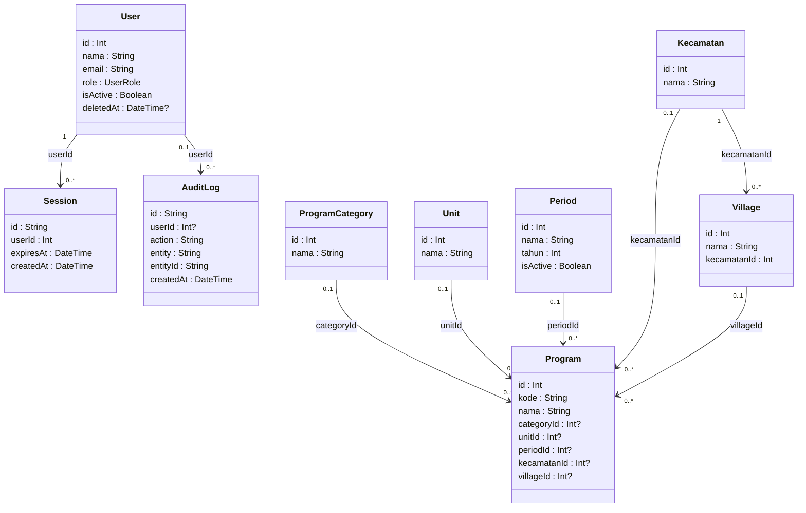
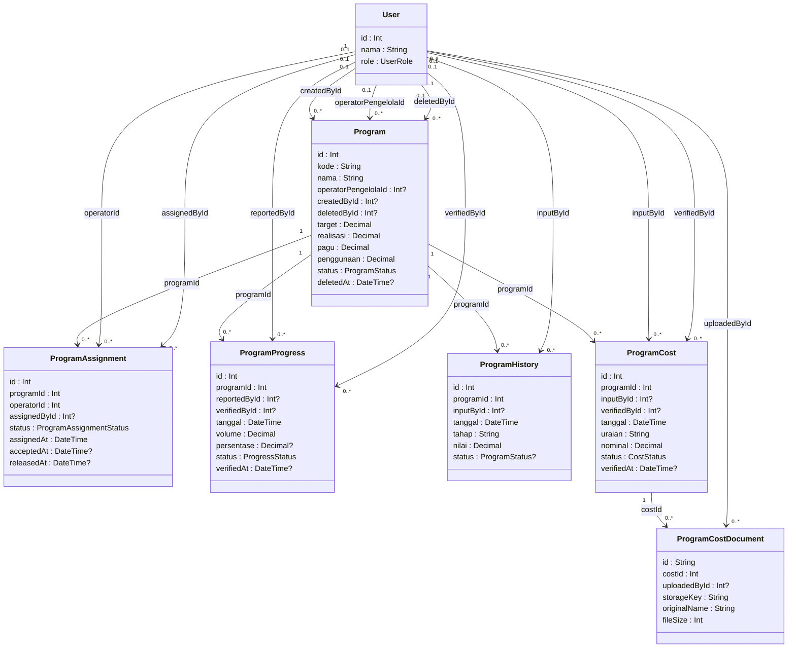
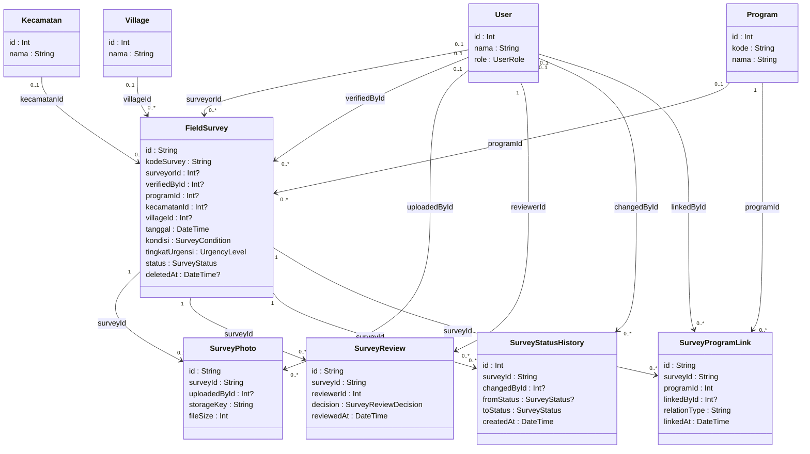
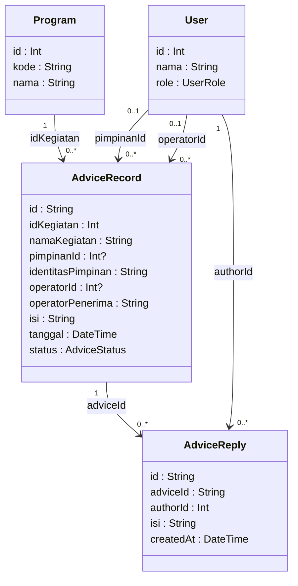
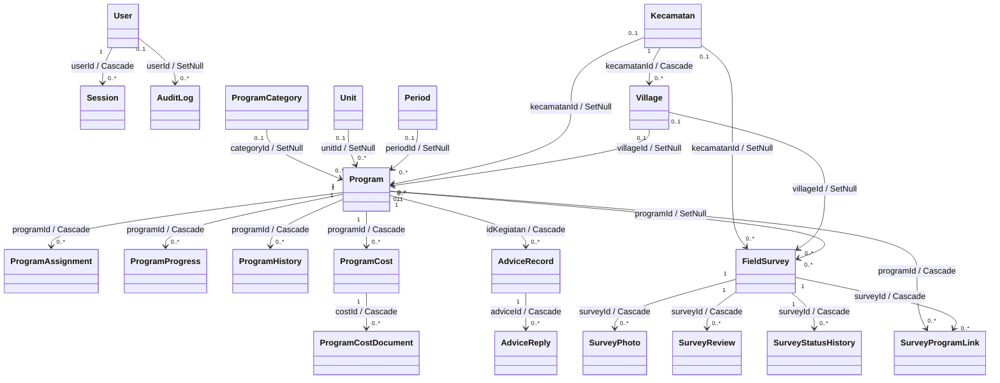
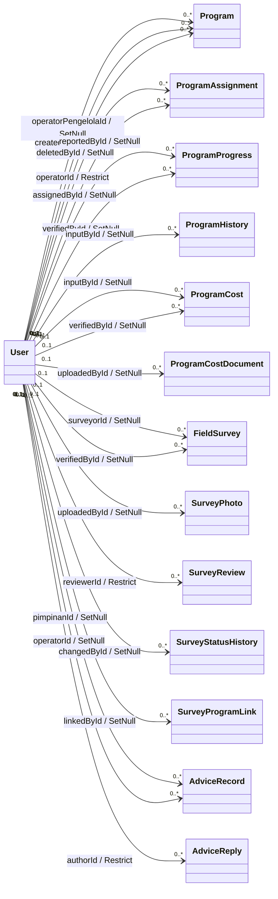

# Class Diagram SIMP Kuningan v4

## 1. Tujuan dan Ruang Lingkup

Dokumen ini menyajikan class diagram model data Sistem Informasi Monitoring
Program Kabupaten Kuningan berdasarkan schema Prisma yang digunakan aplikasi.

Schema yang menjadi acuan memuat 21 model dan 10 enumeration.

Diagram disajikan dalam empat kelompok fungsional:

1. Identitas dan Data Master.
2. Pengelolaan Program.
3. Siklus Survei.
4. Arahan dan Tindak Lanjut.

Pembagian tersebut bertujuan meningkatkan keterbacaan diagram pada laporan
Kerja Praktik. Setiap kelompok merupakan sudut pandang terhadap model sistem
yang sama, bukan database atau aplikasi yang terpisah.

Kelas yang muncul pada lebih dari satu diagram, seperti `User`, `Program`,
`Kecamatan`, dan `Village`, merujuk pada model yang sama.

### 1.1 Batasan pemodelan

- Nama kelas mengikuti nama model Prisma.
- Diagram konteks hanya menampilkan atribut yang relevan dengan pembahasan.
- Seluruh model dan relasi FK ditampilkan kembali pada lampiran relasi.
- Detail atribut, panjang kolom, presisi Decimal, default, dan index mengacu
  pada schema Prisma serta kamus data.
- Enumeration disajikan sebagai tabel, bukan sebagai kelas tambahan.
- Operasi kelas tidak ditampilkan karena schema Prisma tidak mendefinisikan
  metode domain maupun kontrak layanan backend.
- Aturan otorisasi dan perpindahan status harus dikonfirmasi dari implementasi
  backend atau dokumen kebutuhan.
- Pengelompokan fungsional pada dokumen ini tidak dengan sendirinya menyatakan
  adanya bounded context DDD atau aggregate yang telah diimplementasikan.

### 1.2 Konvensi

| Elemen | Notasi |
|---|---|
| Atribut | `nama : Tipe` |
| Nilai nullable | `Tipe?` |
| Asosiasi | `-->` |
| Tepat satu | `1` |
| Nol atau satu | `0..1` |
| Nol atau banyak | `0..*` |
| Identifier | Ditulis sebagai atribut `id` |
| Foreign key | Menggunakan nama field FK pada schema |

Visibility atribut tidak dicantumkan karena schema Prisma tidak menetapkan
visibility UML seperti private atau public.

Arah panah pada diagram merupakan konvensi pembacaan dari kelas induk atau
kelas yang direferensikan menuju kelas pemilik FK. Arah tersebut tidak
menyatakan bahwa akses objek hanya dapat dilakukan dalam satu arah.

Label relasi menggunakan nama FK agar mudah ditelusuri kembali ke schema.

Apabila terdapat beberapa FK antara pasangan kelas yang sama, setiap FK
ditampilkan sebagai relasi terpisah agar peran dan kardinalitasnya tetap tepat.

## 2. Diagram Konteks

### 2.1 Identitas dan Data Master

**Gambar 4.x Class Diagram Konteks Identitas dan Data Master**

Konteks identitas dan data master menggambarkan data pengguna, sesi
autentikasi, catatan audit, dan data referensi program. Setiap sesi wajib
terhubung dengan satu pengguna, sedangkan catatan audit dapat tidak memiliki
referensi pengguna. Data program dapat merujuk kategori, satuan, periode,
kecamatan, dan desa atau kelurahan. Setiap desa atau kelurahan wajib berada
dalam satu kecamatan.

Relasi `Kecamatan` dan `Village` dengan `FieldSurvey` ditampilkan pada
diagram konteks siklus survei.

### 2.2 Pengelolaan Program

**Gambar 4.x Class Diagram Konteks Pengelolaan Program**

Konteks pengelolaan program menggambarkan program beserta penugasan operator,
pencatatan progres, riwayat, dan biaya pelaksanaannya. Setiap penugasan,
progres, riwayat, dan biaya wajib terhubung dengan satu program. Biaya dapat
memiliki beberapa dokumen pendukung. Hubungan pengguna dipisahkan berdasarkan
perannya agar pembuat program, pengelola, penerima penugasan, penginput,
pelapor, dan pemeriksa tidak dianggap sebagai satu relasi yang sama.

`ProgramProgress` dan `ProgramHistory` merupakan dua model yang berbeda.
Schema tidak memiliki FK langsung di antara keduanya dan tidak menetapkan
mekanisme sinkronisasi otomatis.

### 2.3 Siklus Survei

**Gambar 4.x Class Diagram Konteks Siklus Survei**

Konteks siklus survei menggambarkan survei lapangan beserta foto, hasil
peninjauan, riwayat perubahan status, dan hubungannya dengan program.
Setiap foto, peninjauan, riwayat status, dan tautan program wajib terhubung
dengan satu survei. Peninjauan wajib memiliki pengguna sebagai reviewer,
sedangkan beberapa peran pengguna lainnya bersifat opsional. Referensi
wilayah dan referensi program langsung pada survei juga bersifat opsional.

`FieldSurvey.programId` merupakan referensi langsung ke paling banyak satu
program. Sementara itu, `SurveyProgramLink` menyimpan pasangan survei dan
program secara eksplisit. Kedua struktur tersebut dipertahankan karena
keduanya terdapat dalam schema.

Makna operasional `relationType`, hubungan program utama, serta mekanisme
konversi survei harus dijelaskan berdasarkan implementasi backend. Schema
sendiri belum menetapkan bahwa semua tautan merupakan hasil konversi.

### 2.4 Arahan dan Tindak Lanjut

**Gambar 4.x Class Diagram Konteks Arahan dan Tindak Lanjut**

Konteks arahan dan tindak lanjut menggambarkan arahan terkait program serta
balasan yang diberikan pengguna. Setiap arahan wajib terkait dengan satu
program dan dapat memiliki beberapa balasan. Referensi pengguna sebagai
pimpinan dan operator penerima bersifat opsional, sedangkan setiap balasan
wajib memiliki seorang penulis. Nama pimpinan dan operator penerima juga
tersedia sebagai atribut teks pada record arahan.

Schema tidak menetapkan bahwa penulis balasan harus sama dengan operator
penerima, maupun bahwa pembuatan balasan otomatis mengubah status arahan.
Ketentuan tersebut merupakan aturan aplikasi yang perlu diverifikasi.

## 3. Enumeration

Tabel berikut menggunakan nama anggota enum pada schema Prisma.
Beberapa anggota memiliki `@map` untuk nama nilai yang disimpan di database.

| Enumeration | Nilai pada schema Prisma |
|---|---|
| `UserRole` | `ADMIN`, `OPERATOR`, `PIMPINAN` |
| `ProgramStatus` | `BELUM_DIKERJAKAN`, `SEDANG_DIKERJAKAN`, `SELESAI_DIKERJAKAN` |
| `ProgramAssignmentStatus` | `DITUGASKAN`, `DITERIMA`, `DITOLAK`, `DILEPAS` |
| `ProgressStatus` | `DRAFT`, `DIAJUKAN`, `DIVERIFIKASI`, `DITOLAK` |
| `CostStatus` | `DRAFT`, `DIAJUKAN`, `DIVERIFIKASI`, `DITOLAK` |
| `SurveyCondition` | `BAIK`, `RUSAK_RINGAN`, `RUSAK_SEDANG`, `RUSAK_BERAT` |
| `UrgencyLevel` | `RENDAH`, `SEDANG`, `TINGGI_MENDESAK` |
| `SurveyStatus` | `DRAFT`, `SELESAI_SURVEY`, `MENUNGGU_VERIFIKASI`, `PERLU_REVISI`, `DIVERIFIKASI`, `DIKONVERSI` |
| `SurveyReviewDecision` | `DISETUJUI`, `DITOLAK`, `PERLU_REVISI` |
| `AdviceStatus` | `BELUM_DITINDAKLANJUTI`, `SUDAH_DITINDAKLANJUTI` |

Nilai enum membatasi pilihan nilai field, tetapi tidak dengan sendirinya
menentukan urutan perpindahan status.

## 4. Status dan Aturan Workflow

### 4.1 Default status pada schema

| Model | Field | Default pada schema |
|---|---|---|
| `ProgramAssignment` | `status` | `DITUGASKAN` |
| `ProgramProgress` | `status` | `DIAJUKAN` |
| `ProgramCost` | `status` | `DIAJUKAN` |
| `Program` | `status` | Tidak didefinisikan |
| `FieldSurvey` | `status` | Tidak didefinisikan |
| `AdviceRecord` | `status` | Tidak didefinisikan |

Dengan demikian, tidak tepat menyatakan seluruh progres dan biaya selalu
dibuat dalam status `DRAFT`. Apabila nilai status tidak diberikan pada
pembuatan melalui Prisma, default kedua model tersebut adalah `DIAJUKAN`.

Untuk model yang tidak memiliki default status, nilai status perlu diberikan
saat pembuatan record melalui Prisma.

### 4.2 Aturan aplikasi yang perlu diverifikasi

Ketentuan berikut tidak dapat dipastikan hanya dari schema:

- Survei harus diverifikasi sebelum dikonversi menjadi program.
- Hanya pengguna dengan role `ADMIN` yang dapat memverifikasi survei.
- Konversi survei selalu mengisi `FieldSurvey.programId`.
- Konversi survei selalu membuat `SurveyProgramLink`.
- Keputusan review `DITOLAK` menghasilkan status survei tertentu.
- Progres atau biaya yang ditolak dapat diajukan ulang.
- Realisasi program dihitung hanya dari progres yang diverifikasi.
- Penggunaan anggaran dihitung hanya dari biaya yang diverifikasi.
- Program hanya dapat memiliki satu operator aktif.
- Balasan arahan otomatis mengubah status tindak lanjut.

Apabila ketentuan tersebut telah diimplementasikan, cantumkan sebagai aturan
bisnis dengan acuan kode backend atau dokumen kebutuhan.

Diagram transisi status sebaiknya disusun setelah aturan tersebut
dikonfirmasi, agar tidak menampilkan urutan yang hanya diasumsikan.

## 5. Aturan Referensial dan Penghapusan

Seluruh hubungan ditampilkan sebagai asosiasi agar pemodelan tidak
menyamakan aturan penghapusan database dengan komposisi UML.

### 5.1 `onDelete: Cascade`

Penghapusan fisik record induk menyebabkan record terkait ikut dihapus
pada relasi berikut.

| Model induk | Model pemilik FK | Foreign key |
|---|---|---|
| `User` | `Session` | `userId` |
| `Kecamatan` | `Village` | `kecamatanId` |
| `Program` | `ProgramAssignment` | `programId` |
| `Program` | `ProgramProgress` | `programId` |
| `Program` | `ProgramHistory` | `programId` |
| `Program` | `ProgramCost` | `programId` |
| `Program` | `AdviceRecord` | `idKegiatan` |
| `Program` | `SurveyProgramLink` | `programId` |
| `ProgramCost` | `ProgramCostDocument` | `costId` |
| `FieldSurvey` | `SurveyPhoto` | `surveyId` |
| `FieldSurvey` | `SurveyReview` | `surveyId` |
| `FieldSurvey` | `SurveyStatusHistory` | `surveyId` |
| `FieldSurvey` | `SurveyProgramLink` | `surveyId` |
| `AdviceRecord` | `AdviceReply` | `adviceId` |

### 5.2 `onDelete: Restrict`

Penghapusan fisik pengguna dibatasi apabila pengguna tersebut masih
direferensikan oleh record berikut.

| Model yang direferensikan | Model pemilik FK | Foreign key |
|---|---|---|
| `User` | `ProgramAssignment` | `operatorId` |
| `User` | `SurveyReview` | `reviewerId` |
| `User` | `AdviceReply` | `authorId` |

### 5.3 `onDelete: SetNull`

Relasi lainnya pada schema yang diberikan menggunakan `SetNull`.
Penghapusan fisik record yang direferensikan menyebabkan FK terkait
menjadi `NULL`, bukan menghapus record pemilik FK.

Contohnya:

- Penghapusan pengguna dapat mengosongkan `Program.createdById`.
- Penghapusan program dapat mengosongkan `FieldSurvey.programId`.
- Penghapusan kategori dapat mengosongkan `Program.categoryId`.

### 5.4 Soft delete

Field `deletedAt` tersedia pada:

- `User`.
- `Program`.
- `FieldSurvey`.

Keberadaan field tersebut mendukung pencatatan soft delete, tetapi tidak
membuktikan bahwa filter soft delete telah diterapkan pada seluruh query.

Mengubah `deletedAt` bukan penghapusan fisik record. Oleh karena itu,
perubahan tersebut tidak dengan sendirinya menjalankan `onDelete`.

Mekanisme penyaringan data terhapus, penonaktifan pengguna, dan pencabutan
sesi harus diperiksa pada implementasi aplikasi.

## 6. Lampiran Keterlacakan Model dan Relasi

Lampiran dibagi menjadi dua diagram agar hubungan tetap dapat dibaca.

Diagram lampiran menampilkan seluruh model dan relasi FK, tetapi tidak
mengulang seluruh atribut. Untuk tipe native database, panjang kolom,
default, index, dan constraint lengkap, gunakan schema Prisma dan kamus data.

### 6.1 Relasi Struktural Antarentitas

### 6.2 Relasi Pengguna Berdasarkan Peran

Relasi sesi dan audit telah ditampilkan pada lampiran sebelumnya.
Diagram berikut melengkapi seluruh FK pengguna lainnya.

### 6.3 Daftar Model

| No. | Model | Diagram konteks utama |
|---|---|---|
| 1 | `User` | Identitas dan Data Master |
| 2 | `Session` | Identitas dan Data Master |
| 3 | `AuditLog` | Identitas dan Data Master |
| 4 | `ProgramCategory` | Identitas dan Data Master |
| 5 | `Unit` | Identitas dan Data Master |
| 6 | `Kecamatan` | Identitas dan Data Master |
| 7 | `Village` | Identitas dan Data Master |
| 8 | `Period` | Identitas dan Data Master |
| 9 | `Program` | Pengelolaan Program |
| 10 | `ProgramAssignment` | Pengelolaan Program |
| 11 | `ProgramProgress` | Pengelolaan Program |
| 12 | `ProgramHistory` | Pengelolaan Program |
| 13 | `ProgramCost` | Pengelolaan Program |
| 14 | `ProgramCostDocument` | Pengelolaan Program |
| 15 | `FieldSurvey` | Siklus Survei |
| 16 | `SurveyPhoto` | Siklus Survei |
| 17 | `SurveyReview` | Siklus Survei |
| 18 | `SurveyStatusHistory` | Siklus Survei |
| 19 | `SurveyProgramLink` | Siklus Survei |
| 20 | `AdviceRecord` | Arahan dan Tindak Lanjut |
| 21 | `AdviceReply` | Arahan dan Tindak Lanjut |

## 7. Constraint Penting

Berikut beberapa constraint yang perlu dijelaskan pada kamus data atau
pembahasan perancangan database.

| Model | Constraint | Makna |
|---|---|---|
| `User` | `email @unique` | Email pengguna harus unik. |
| `Session` | `tokenHash @unique` | Hash token sesi harus unik. |
| `ProgramCategory` | `nama @unique` | Nama kategori harus unik. |
| `Unit` | `nama @unique` | Nama satuan harus unik. |
| `Kecamatan` | `nama @unique` | Nama kecamatan harus unik. |
| `Village` | `@@unique([kecamatanId, nama])` | Nama desa unik dalam kecamatan yang sama. |
| `Period` | `@@unique([nama, tahun])` | Kombinasi nama periode dan tahun harus unik. |
| `Program` | `kode @unique` | Kode program harus unik. |
| `FieldSurvey` | `kodeSurvey @unique` | Kode survei harus unik. |
| `SurveyProgramLink` | `@@unique([surveyId, programId])` | Pasangan survei dan program tidak boleh berulang. |

Constraint `SurveyProgramLink` tidak membatasi satu survei hanya boleh
berhubungan dengan satu program. Satu survei dapat memiliki beberapa record
tautan selama pasangan survei dan program berbeda.

Schema juga tidak memiliki constraint unik yang membatasi satu program
hanya boleh memiliki satu penugasan berstatus aktif.

## 8. Catatan Konsistensi Data

### 8.1 Referensi dan atribut teks

Beberapa informasi disimpan dalam bentuk referensi sekaligus atribut teks,
misalnya:

- `Program.categoryId` dan `Program.kategori`.
- `Program.periodId` dan `Program.periode`.
- `Program.unitId` dan `Program.satuan`.
- `Program.kecamatanId` dan `Program.kecamatan`.
- `Program.villageId` dan `Program.desaKelurahan`.
- `Program.operatorPengelolaId` dan `Program.operatorPengelola`.
- `FieldSurvey.surveyorId` dan `FieldSurvey.surveyor`.
- `AdviceRecord.pimpinanId` dan `AdviceRecord.identitasPimpinan`.
- `AdviceRecord.operatorId` dan `AdviceRecord.operatorPenerima`.

Schema tidak menjelaskan apakah atribut teks merupakan snapshot historis,
data impor, atau representasi tampilan yang disinkronkan dengan data master.

Kebijakan pengisian dan pembaruannya perlu didokumentasikan berdasarkan
implementasi agar tidak terjadi perbedaan informasi.

### 8.2 Konsistensi wilayah

`Program` dan `FieldSurvey` masing-masing menyimpan `kecamatanId` dan
`villageId` secara terpisah.

FK yang tersedia memastikan bahwa kecamatan dan desa yang direferensikan
ada, tetapi belum memastikan bahwa desa tersebut berada di kecamatan yang
dipilih.

Kesesuaian `Village.kecamatanId` dengan `kecamatanId` pada program atau
survei perlu dijaga melalui validasi aplikasi atau desain constraint tambahan.

### 8.3 Nilai ringkasan dan rincian

Schema memiliki beberapa field yang memerlukan definisi perhitungan, seperti:

- `target`, `targetAwal`, dan `targetVolume`.
- `realisasi` dan `realisasiVolume`.
- `penggunaan` dan `penggunaanBiaya`.
- `ProgramProgress.volume` dan `ProgramProgress.persentase`.

Dokumen kebutuhan atau implementasi harus menjelaskan:

- Satuan masing-masing field.
- Apakah nilainya diinput atau dihitung.
- Apakah progres bersifat tambahan per laporan atau kumulatif.
- Status record yang disertakan dalam perhitungan.
- Kapan nilai ringkasan diperbarui.

Tidak ada rumus perhitungan yang dapat dipastikan hanya dari definisi schema.

## 9. Penempatan dalam Laporan KP

### Bab Perancangan Sistem

Tampilkan empat diagram konteks:

1. Class Diagram Konteks Identitas dan Data Master.
2. Class Diagram Konteks Pengelolaan Program.
3. Class Diagram Konteks Siklus Survei.
4. Class Diagram Konteks Arahan dan Tindak Lanjut.

Setiap gambar diberi nomor sesuai urutan pada pedoman laporan dan disertai
paragraf penjelasan.

### Lampiran

Tempatkan:

- Diagram relasi struktural antarentitas.
- Diagram relasi pengguna berdasarkan peran.
- Kamus data lengkap atau referensi schema sesuai ketentuan kampus.

Jika suatu diagram tidak terbaca pada ukuran cetak, diagram dapat dipisah
lagi berdasarkan subfitur tanpa mengubah arti relasi.

### Contoh pengantar

Untuk meningkatkan keterbacaan, class diagram Sistem Informasi Monitoring
Program Kabupaten Kuningan disajikan dalam empat kelompok fungsional, yaitu
identitas dan data master, pengelolaan program, siklus survei, serta arahan
dan tindak lanjut. Seluruh diagram merupakan sudut pandang dari model data
yang sama. Diagram pada bab perancangan menampilkan atribut terpilih,
sedangkan rincian struktur data dijelaskan melalui kamus data dan lampiran
relasi.
