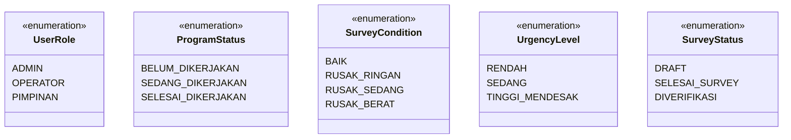

# Class Diagram Project SIMP Kuningan

Diagram ini adalah blueprint konseptual berdasarkan model Prisma dan modul
backend/client yang sudah ada. Detail atribut dapat disederhanakan saat
digambar ulang.

## 1. Domain dan layer

```mermaid
classDiagram
    direction TB

    class ApiClient {
        +request(path, options)
        +get(path, query)
        +post(path, body)
        +patch(path, body)
        +delete(path)
    }

    class AuthClient {
        +login(input)
        +logout()
        +me()
    }
    class UserClient {
        +list(filters)
        +get(id)
        +create(input)
        +update(id, input)
        +remove(id)
    }
    class ProgramClient {
        +list(filters)
        +get(id)
        +create(input)
        +update(id, input)
        +remove(id)
        +claim(id)
        +addProgress(id, input)
        +addCost(id, input)
        +complete(id, input)
    }
    class SurveyClient {
        +list(filters)
        +get(id)
        +create(input)
        +update(id, input)
        +remove(id)
        +verify(id, programId)
        +convert(id, input)
    }
    class AdviceClient {
        +list(filters)
        +get(id)
        +create(input)
        +updateStatus(id, status)
        +remove(id)
    }
    class ReportClient {
        +summary(query)
    }
    class SystemClient {
        +health()
        +ready()
    }

    class RouteHandler {
        +GET(request)
        +POST(request)
        +PATCH(request)
        +DELETE(request)
    }

    class SchemaParser {
        +parseCreateInput(body)
        +parseUpdateInput(body)
        +parsePagination(params)
    }

    class UserService {
        +list(pagination)
        +create(input)
        +get(id)
        +update(id, input)
        +remove(id)
    }
    class ProgramService {
        +list(filters)
        +create(input)
        +get(id)
        +update(id, input)
        +assertCanEdit(id, user)
        +remove(id, deletedById)
    }
    class SurveyService {
        +list(pagination)
        +get(id)
        +create(input)
        +update(id, input)
        +remove(id)
        +verify(id, programId)
        +convertToProgram(id, input)
    }
    class AdviceService {
        +list(pagination)
        +get(id)
        +create(input)
        +updateStatus(id, status)
        +remove(id)
    }
    class AuthService {
        +login(input)
        +authenticate(token)
        +logout(token)
    }

    class AuthRepository {
        +findUserByEmail(email)
        +findUserById(id)
        +createUserSession(input)
        +setSessionTokenHash(id, tokenHash)
        +findSession(tokenHash)
        +deleteSession(tokenHash)
        +deleteExpiredSessions()
    }
    class UserRepository {
        +findMany(pagination)
        +findByEmail(email)
        +create(input)
        +findById(id)
        +update(id, input)
        +delete(id)
    }
    class ProgramRepository {
        +findMany(filters)
        +findById(id)
        +create(input)
        +update(id, input)
        +delete(id, deletedById)
    }
    class SurveyRepository {
        +findMany(pagination)
        +findById(id)
        +create(input, id)
        +update(id, input)
        +delete(id)
    }
    class AdviceRepository {
        +findMany(pagination)
        +findById(id)
        +create(input)
        +update(id, data)
        +delete(id)
    }

    class ProgramActions {
        +addProgress(programId, input, userId, userName)
        +addCost(programId, input, userId, userName)
        +markComplete(programId, userId, userName, foto)
    }

    class PrismaClient {
        +user
        +program
        +fieldSurvey
        +adviceRecord
        +programHistory
        +programCost
    }

    AuthClient --> ApiClient
    UserClient --> ApiClient
    ProgramClient --> ApiClient
    SurveyClient --> ApiClient
    AdviceClient --> ApiClient
    ReportClient --> ApiClient
    SystemClient --> ApiClient

    RouteHandler --> SchemaParser
    RouteHandler --> AuthService
    RouteHandler --> UserService
    RouteHandler --> ProgramService
    RouteHandler --> SurveyService
    RouteHandler --> AdviceService

    AuthService --> AuthRepository
    UserService --> UserRepository
    ProgramService --> ProgramRepository
    ProgramService --> ProgramActions
    SurveyService --> SurveyRepository
    AdviceService --> AdviceRepository

    AuthRepository --> PrismaClient
    UserRepository --> PrismaClient
    ProgramRepository --> PrismaClient
    SurveyRepository --> PrismaClient
    AdviceRepository --> PrismaClient
    ProgramActions --> PrismaClient
```

## 2. Entitas domain dan relasi

```mermaid
classDiagram
    direction LR

    class User {
        +Int id
        +String nama
        +String email
        +UserRole role
        +DateTime createdAt
        +DateTime updatedAt
        --
        +login(email, password)
        +logout()
        +create()
        +update()
        +delete()
        +list()
        +get(id)
    }

    class Session {
        +String id
        +String tokenHash
        +Int userId
        +DateTime expiresAt
        +DateTime createdAt
        --
        +create()
        +authenticate()
        +authenticate(token)
        +deleteExpired()
        +delete(token)
    }

    class ProgramCategory {
        +Int id
        +String nama
        --
        +create()
        +update()
        +delete()
        +getPrograms()
    }

    class Unit {
        +Int id
        +String nama
        --
        +create()
        +update()
        +delete()
        +getPrograms()
    }

    class Kecamatan {
        +Int id
        +String nama
        --
        +create()
        +update()
        +delete()
        +getPrograms()
        +getSurveys()
    }

    class Program {
        +Int id
        +String kode
        +String nama
        +String lokasi
        +String periode
        +String satuan
        +Decimal target
        +Decimal realisasi
        +ProgramStatus status
        +Decimal pagu
        +Decimal penggunaan
        +DateTime tanggalMulai
        +DateTime tanggalSelesai
        +DateTime deletedAt
        --
        +list(filters)
        +get(id)
        +create(input)
        +update(id, input)
        +delete(id, deletedById)
        +claim(id)
        +addProgress(id, input)
        +addCost(id, input)
        +complete(id, foto)
        +calculateProgress()
        +calculateBudgetUsage()
    }

    class ProgramHistory {
        +Int id
        +DateTime tanggal
        +String tahap
        +Decimal nilai
        +String satuan
        +String keterangan
        +Boolean foto
        +ProgramStatus status
        --
        +listByProgram(programId)
        +create(input)
        +recordProgress()
    }

    class ProgramCost {
        +Int id
        +DateTime tanggal
        +String uraian
        +Decimal nominal
        +String input
        +Boolean bukti
        --
        +listByProgram(programId)
        +create(input)
        +recordCost()
    }

    class FieldSurvey {
        +String id
        +String kodeSurvey
        +DateTime tanggal
        +String surveyor
        +SurveyCondition kondisi
        +UrgencyLevel tingkatUrgensi
        +String uraianTemuan
        +String rekomendasi
        +SurveyStatus status
        --
        +list(filters)
        +get(id)
        +create(input)
        +update(id, input)
        +delete(id)
        +verify(id, programId)
        +convertToProgram(id, input)
    }

    class AdviceRecord {
        +String id
        +Int idKegiatan
        +String identitasPimpinan
        +String operatorPenerima
        +String isi
        +DateTime tanggal
        +String status
        --
        +list(filters)
        +get(id)
        +create(input)
        +updateStatus(id, status)
        +delete(id)
    }

    class AuditLog {
        +String id
        +Int userId
        +String action
        +String entity
        +String entityId
        +Json details
        +DateTime createdAt
        --
        +create(action, entity, entityId, details)
        +listByUser(userId)
        +listByEntity(entity, entityId)
    }

    User "1" --> "0..*" Session : owns
    User "0..1" --> "0..*" Program : operates
    User "0..1" --> "0..*" FieldSurvey : surveys
    User "0..1" --> "0..*" ProgramHistory : enters
    User "0..1" --> "0..*" ProgramCost : enters
    User "0..1" --> "0..*" AdviceRecord : receives
    User "0..1" --> "0..*" AdviceRecord : issues

    ProgramCategory "0..1" --> "0..*" Program : categorizes
    Unit "0..1" --> "0..*" Program : measures
    Kecamatan "0..1" --> "0..*" Program : locates
    Kecamatan "0..1" --> "0..*" FieldSurvey : locates

    Program "1" *-- "0..*" ProgramHistory : has progress
    Program "1" *-- "0..*" ProgramCost : has costs
    Program "0..1" --> "0..*" FieldSurvey : relates to
    Program "1" *-- "0..*" AdviceRecord : receives
    User "0..1" --> "0..*" AuditLog : performs
```

## 3. Enumeration

## 4. Panduan menggambar ulang

- Gunakan diagram pertama untuk menjelaskan dependency layer dan alur kode.
- Gunakan diagram kedua untuk menjelaskan database/domain relationship.
- Gunakan diagram ketiga sebagai legenda enum.
- Tampilkan `Program` sebagai pusat domain karena berelasi dengan progres,
  biaya, survey, dan arahan.
- Bedakan relasi composition (`Program` memiliki history/cost/advice) dari
  relasi reference opsional (`Program` ke survey, `User` ke entitas lain).
- Jangan menggambar `ApiClient` sebagai entitas database; ia adalah adapter
  transport frontend.
- Jangan menggambar service atau repository sebagai tabel database; keduanya
  adalah layer aplikasi.

## 5. Ringkasan operation yang tersedia

Gunakan daftar ini sebagai legenda ketika menggambar ulang. `create`/`post`
merepresentasikan operasi `POST`, bukan nama method Prisma literal.

| Domain | Query | Command / action |
|---|---|---|
| Auth | `me` | `login`, `logout` |
| Users | `list`, `get` | `create`, `update`, `delete` |
| Programs | `list`, `get` | `create`, `update`, `delete`, `claim`, `addProgress`, `addCost`, `complete` |
| Surveys | `list`, `get` | `create`, `update`, `delete`, `verify`, `convertToProgram` |
| Advice | `list`, `get` | `create`, `updateStatus`, `delete` |
| Reports | `summary` | - |
| System | `health`, `ready` | - |

Di layer repository, operasi `findMany`/`findById` adalah query, sedangkan
`create`/`update`/`delete` adalah command persistence. `ProgramActions`
mengelompokkan perubahan atomik untuk `addProgress`, `addCost`, dan
`markComplete`.
