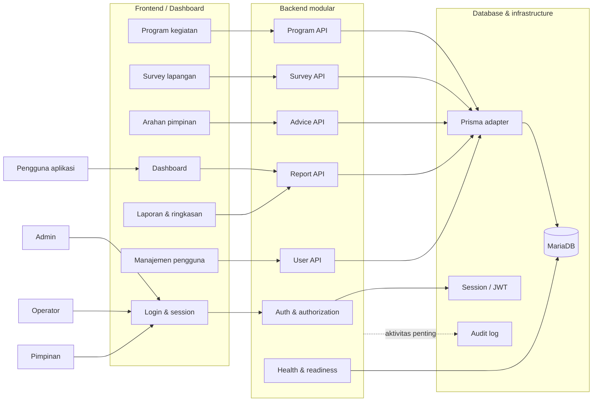

# Rich Picture Project SIMP Kuningan

Dokumen ini adalah gambaran konseptual, bukan diagram teknis formal. Gunakan
sebagai dasar untuk menggambar ulang rich picture di draw.io, Figma, Visio,
atau alat diagram lain.

## 1. Gambaran besar



## 2. Aktor dan kepentingannya

| Aktor | Kebutuhan utama | Interaksi |
|---|---|---|
| Admin | Mengelola pengguna, memverifikasi survey, mengawasi seluruh data | User, program, survey, laporan |
| Operator | Mengelola program yang ditugaskan, progres, biaya, dan survey lapangan | Program, progres, biaya, survey |
| Pimpinan | Melihat perkembangan dan memberi arahan | Dashboard, laporan, advice |
| Pengguna aplikasi | Melihat informasi yang diizinkan sistem | Login, dashboard, data domain |
| Database | Menyimpan data operasional dan relasi | Diakses melalui Prisma |
| Backend terpisah | Menyediakan kontrak HTTP yang stabil | Diakses frontend melalui API client |

## 3. Masalah dan aliran informasi

### Masalah yang ingin diselesaikan

- Data program, survey, progres, biaya, dan arahan harus tersimpan terpusat.
- Setiap role membutuhkan hak akses dan tampilan yang berbeda.
- Data lapangan perlu dapat ditelusuri sampai ke program dan wilayah.
- Pimpinan membutuhkan ringkasan untuk memantau status dan anggaran.
- Frontend harus dapat dipisahkan dari backend tanpa mengubah aturan bisnis.

### Aliran utama

```text
User login
  -> backend memvalidasi kredensial
  -> session dibuat
  -> frontend menerima user dan status session

Operator mengelola program
  -> input program/progres/biaya
  -> route melakukan auth dan validasi
  -> service menjalankan aturan bisnis
  -> repository menyimpan ke database
  -> dashboard membaca response API

Survey lapangan
  -> surveyor mengisi temuan dan kondisi
  -> survey tersimpan sebagai draft/selesai
  -> admin memverifikasi
  -> survey dapat dikaitkan atau dikonversi menjadi program

Pimpinan memberi arahan
  -> arahan dikaitkan ke program dan operator
  -> operator menindaklanjuti
  -> status arahan diperbarui

Laporan
  -> backend mengagregasi program berdasarkan filter
  -> frontend menampilkan ringkasan status dan anggaran
```

## 4. Batas sistem

### Di dalam sistem

- Authentication, session, role, dan authorization.
- CRUD pengguna.
- Program kegiatan, progres, biaya, dan status.
- Survey lapangan dan verifikasi.
- Arahan pimpinan.
- Ringkasan laporan.
- Validasi, pagination, response standar, dan request ID.

### Di luar sistem

- Infrastruktur MariaDB sebagai layanan database.
- Browser dan perangkat pengguna.
- Deployment backend terpisah.
- Peta, file/foto, atau layanan eksternal lain yang mungkin ditambahkan.
- Proses bisnis organisasi di luar data yang dicatat aplikasi.

## 5. Catatan untuk gambar manual

Saat menggambar ulang:

1. Tempatkan aktor di sisi kiri atau luar boundary sistem.
2. Letakkan frontend sebagai area interaksi pengguna.
3. Letakkan backend modular di tengah sebagai pengolah aturan bisnis.
4. Letakkan database dan infrastructure di sisi kanan/bawah.
5. Gunakan panah solid untuk aliran data utama.
6. Gunakan panah putus-putus untuk concern lintas domain seperti audit dan
   health check.
7. Tandai konflik atau risiko: role berbeda, session expired, validasi gagal,
   database tidak siap, dan backend dipisahkan ke deployment lain.
